# ExpressSorting
快递分拣管理系统
亮点：DeepSeek模拟揽收录入、目的地规则匹配算法、ECharts多维分析、任务负载均衡算法、分拣规则冲突校验、快递流转闭环、排班冲突处理、设备运维联动；
角色：快递员、分拣员、管理员；

所有源码均本人开发，项目是前后端分离的，所有的项目都具备了完整的业务逻辑，不仅仅局限于基础的增删改查（CRUD）操作，系统亮点众多。

本文注重于计算机毕业设计选题指导，列出题目均有源码， 大家可以去【公众号】(毕业终点站)获取或者加我【qq】(2112698948)提意见(别忘记Star哟)。备注：git

声明：仅用于学习使用，请勿用于任何商业行为！

1.系统非商用，非开源，非无偿。

2.由本人开发，如需源码，请联系以下方式，qq:2112698948。

3.项目有很多，并未全部上传，如果未找到想要的，可直接咨询。

# 快递分拣管理系统

> B/S 前后端分离 · 管理员 / 分拣员 / 快递员三角色工作台
>
> Spring Boot 3 + Vue 3 + Element Plus + MyBatis-Plus + MySQL + JWT + Apache POI + DeepSeek API

一套从揽收到签收的快递分拣系统：快递员在前台录揽收单、跑派件，分拣员在控制台看任务、扫码核对格口、报异常，管理员在后台配分拣规则、派任务、管设备、排班，再用图表看分拣量、异常类型和人员绩效。三端共用一套数据，一件快递从「待揽收」走到「已签收」，中间每一步都能在另一端的页面上找到对应的记录。

---

## 一、技术栈

| 层次 | 选型 |
| :--- | :--- |
| 架构 | B/S、MVC、前后端分离、管理员 / 分拣员 / 快递员三角色工作台 |
| 运行环境 | Windows |
| 开发工具 | IDEA、JDK 17、Maven、MySQL 8、Node.js |
| 后端 | Java、Spring Boot 3、Spring MVC、MyBatis-Plus、MySQL、JWT、Apache POI、DeepSeek API |
| 前端 | Vue 3、Vite、Element Plus、Vue Router、Pinia、Axios、ECharts |

## 二、角色与功能范围

| 角色 | 主要使用范围 |
| :--- | :--- |
| 分拣员 | 工作台（待分拣 / 分拣中 / 已完成任务数、今日分拣量、今日排班与考勤状态）；我的任务（任务与包裹明细、开始任务、看进度、完成任务、去分拣）；扫码分拣（扫单号查目标格口、确认实际格口、生成分拣记录）；异常上报（类型、说明、图片，跟踪处理结果）；考勤打卡（上下班打卡、今日状态、今日排班）；我的绩效（分拣量、正确分拣量、准确率、效率、趋势与排行榜） |
| 快递员 | 工作台（今日揽收、待派送、派送中、已签收、派送异常、签收率、待处理派件、最新公告）；快递揽收（揽收登记、AI 模拟录入、导出、模板下载、Excel 导入）；快递查询（按单号看状态、收件信息与物流轨迹时间线）；派件管理（开始派送、确认签收、上报派送异常）；我的业绩（揽收 / 派送 / 签收量、签收率、趋势、快递员排名） |
| 管理员 | 控制台；快递管理（快递列表、物流轨迹、异常件）；分拣管理（分拣区域、分拣格口、分拣规则与规则校验、分拣任务、分拣记录）；设备管理（设备监控、分拣设备、设备故障、维护记录）；人员管理（考勤记录、排班计划、绩效数据）；数据分析；用户管理（管理员、分拣员、快递员）；系统管理（系统公告、操作日志） |

## 三、功能亮点

- **目的地规则匹配算法**：按规则优先级依次匹配省、市、区，命中的规则决定目标格口，再按区域把包裹聚成任务；一次匹配同时返回匹配数与未匹配数，不必逐件手动分配格口。
- **任务负载均衡算法**：分配前先统计每个分拣员当前未完成的任务数，优先给任务少的人，分完即更新负载，让已有任务和新增任务都算进去。
- **分拣规则冲突校验**：查缺少目的省份、格口绑定异常、重复目的地，以及高优先级宽泛规则把细化规则盖住这几类问题，配规则时先跑一遍校验再保存。
- **DeepSeek 模拟揽收录入**：一次生成 1 到 10 条包裹资料，字段校验通过后入库并生成单号，用来快速铺演示数据。
- **快递流转全流程**：揽收 → 分拣调度 → 扫码核验 → 派送 → 签收，异常走独立处理通道；每个环节都联动任务进度、物流轨迹和人员绩效。
- **排班冲突处理**：批量排班前先预览冲突，可以跳过也可以覆盖已有排班，另有一键复制上周排班再做微调。
- **设备运维联动**：设备状态与故障记录绑在一起，维护完成后回写设备状态并结掉未解决故障，运维过程留痕。
- **ECharts 多维分析**：分拣趋势、区域工作量、异常类型、时段分布、目的地分布、设备状态，配分拣员与快递员绩效排行榜。

---

## 四、界面展示

> 说明：源文档首图为三角色共用登录页，未提供独立的系统总览图，故「登录入口」单独成节，首图不充当总览横幅。全部截图为 2.16:1 的桌面宽屏后台页面，一律全宽单图排布，避免表格文字被压糊。

### 4.1 登录入口

左侧是分拣流水线插画——蓝色分拣台上的包裹滑向 A 区、B 区、C 区三个格口，下方一行「智能分拣 · 高效配送 / 全流程数字化管理，让每一件快递精准到达」。右侧登录卡依次是账号、密码、角色下拉（不预设角色，需要手动选）与验证码。

三个角色共用这一个入口，靠角色下拉切换身份：选分拣员进控制台看任务，选快递员进揽收与派件，选管理员进配置与调度后台。

### 4.2 分拣员端

左侧菜单五项：工作台、我的任务、扫码分拣、异常上报、考勤打卡、我的绩效，右上角显示当前账号 sorter001 与「分拣员」标签。

#### 分拣工作台

顶部四张卡：待分拣任务 1（尚未开始）、分拣中任务 1（正在处理）、已完成任务 18（今日已完成）、今日分拣量 4（来自分拣记录）。下方左侧「我的待办任务」列出 ZXFJ-W-1-2 与 ZXFJ-W-1-3 两条，都是华东分拣区、进度 0/1，状态分别是「待分拣」和「分拣中」。

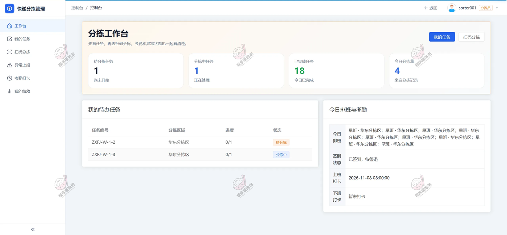

右侧「今日排班与考勤」把当天状态摊开：今日排班写着早班 · 华东分拣区，签到状态「已签到，待签退」，上班打卡 2026-11-08 08:00:00，下班打卡「暂未打卡」。分拣员一进系统就知道今天要干什么、有没有打卡。

#### 我的任务

四张卡口径比工作台更全：待分拣任务 1、分拣中任务 1、已完成任务 33、任务完成率 94.29%。

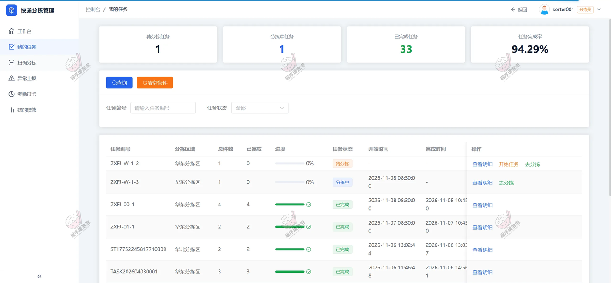

完成率不是拍的，能算出来——已完成 33 除以总数 35（33 已完成 + 1 待分拣 + 1 分拣中）= 94.2857%，页面显示 94.29%。列表里能看到时间链条：ZXFJ-00-1 华东分拣区 4 件，2026-11-08 08:30:00 开始、10:45 完成，进度条满格标「已完成」；ZXFJ-01-1 是前一天 11-07 的 2 件，同样 08:30 开工、10:45 收工。待办的两条只有「开始任务」「去分拣」按钮，已完成的只剩「查看详情」，按钮跟着状态走。

#### 扫码分拣

一个输入框，扫码或手输单号后点查询，跳到目标格口确认。下面「最近分拣记录」10 条，每行给出目标格口、实际格口、是否正确、分拣时间。

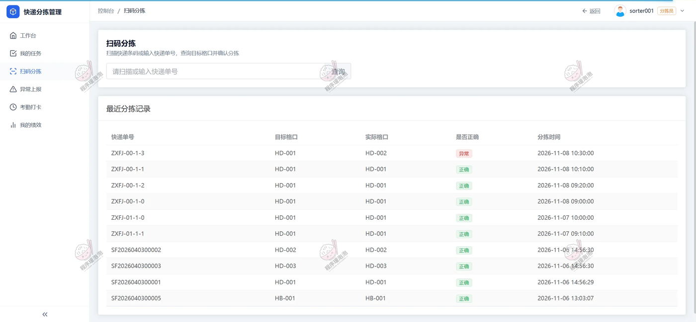

这页最能看出格口校验在做事：ZXFJ-00-1-3 目标格口 HD-001、实际格口 HD-002，最后判定「异常」；其余九条目标与实际一致，全部「正确」。2026-11-08 当天有 09:00、09:20、10:10、10:30 四条记录，正好对上工作台那张「今日分拣量 4」。

#### 异常上报

表单四项：快递单号（下拉选）、异常类型、异常描述（限 300 字，提示写清现场情况，例如面单破损、收件地址无法识别）、异常图片上传。

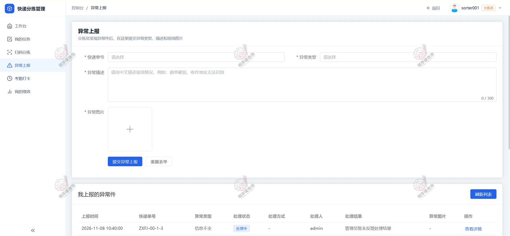

下方「我上报的异常件」只有一条：2026-11-08 10:40:00、ZXFJ-00-1-3、信息不全、处理中、处理人 admin，处理结果栏写着「管理员暂未反馈处理结果」。上报的单号正是扫码页判为异常的那一件，分拣员发现格口不对之后转手就报了异常。

#### 考勤打卡

顶部四块：今日状态「已签到」、上班打卡时间 2026-11-08 08:00:00、下班打卡时间「暂未打卡」、今日排班数量 9 个班次。按钮是上班打卡、下班打卡、刷新状态，下面一行提示「sorter001，你今天安排在【华东分拣区】早班，记得按时完成上下班打卡。」

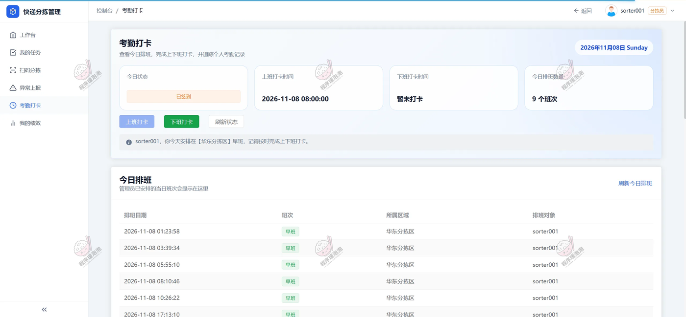

「今日排班」把 9 条班次全列出来：2026-11-08 的 01:23:58、03:39:34、05:55:10、08:10:46、10:26:22、17:13:10……全是早班 · 华东分拣区 · sorter001。一天九条同班次的记录，是管理员那边批量排班反复排同一人造成的，也正是「批量排班前预览冲突」这个功能要解决的情况。

#### 我的绩效

四张卡：本月分拣量 34、正确分拣量 31、分拣准确率 91.18%、分拣效率 0.62 件/小时，下面一行绿条写「张伟当前排名第 1 / 4 名，本月累计分拣 34 件，准确率 91.18%」。

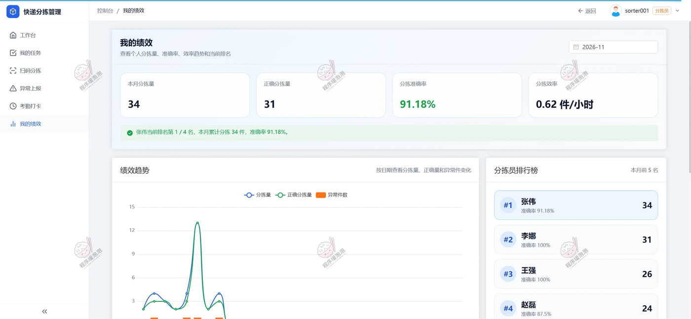

91.18% 同样是算得出来的：31 ÷ 34 = 91.176%，四舍五入 91.18%。左侧「绩效趋势」按日期叠三条线——分拣量、正确分拣量、异常件数，横轴从月初拉到 11-08，中间那个尖峰对应某天集中分拣。右侧「分拣员排行榜」四人：张伟 34 件 / 91.18%、李娜 31 件 / 100%、王强 26 件 / 100%、赵磊 24 件 / 87.5%——分拣量高的准确率不一定高，两个指标分开排才有意义。

### 4.3 快递员端

左侧菜单五项：工作台、快递揽收、快递查询、派件管理、我的业绩，右上角是 courier001 / 快递员。

#### 快递员工作台

六张卡：今日揽收 7（今天揽收）、待派送 30（等待开始）、派送中 31（正在派送）、已签收 21（完成签收）、派送异常 10（异常待处理）、签收率 40.38%（签收完成率）。

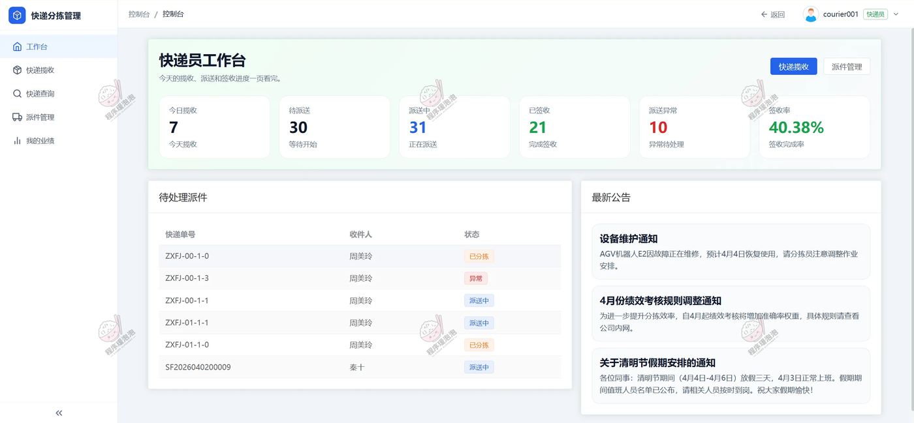

签收率 21 ÷（21 + 31）= 40.38%，只看已签收和派送中这两个已进入末端环节的量，不含还没开始派送的 30 件。左侧「待处理派件」六条，状态从「已分拣」到「派送中」再到「异常」都有：ZXFJ-00-1-3 标着异常，就是分拣员报过的那一件。右侧「最新公告」三条——AGV 机器人 E2 故障维修预计 4 月 4 日恢复、4 月绩效考核规则调整、清明节放假安排，设备公告直接落到快递员这一层。

#### 快递揽收

查询栏下面七个按钮：揽收登记、AI 模拟录入、导出、下载导入模板、Excel 导入。

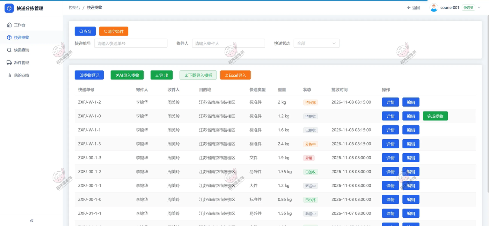

列表九条揽收记录，字段是快递单号、寄件人、收件人、目的地、快递类型、重量、状态、揽收时间。状态这一列把整条链摊开了：待揽收 → 已揽收 → 待分拣 → 分拣中 → 已分拣 → 派送中 → 已签收，中间还夹着一条「异常」。快递类型分了标准件、文件、易碎件、大件，重量从 0.85 kg 到 2.4 kg 不等。操作列按状态给不同按钮，比如 ZXFJ-W-1-1 已揽收那条多一个「完成揽收」，其余是详情、编辑。

#### 快递查询

单号输入框 + 立即查询，下方「最近查询的派件快递」八条，每行只有单号、收件人、状态和查询按钮。

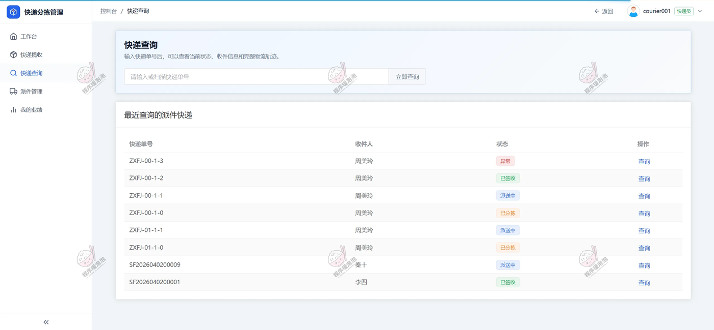

点「查询」进详情看收件信息与物流轨迹时间线，这一页只做入口，查询记录本身也留档。

#### 派件管理

四张卡精简版：待派送 30、派送中 31、已签收 21、派送异常 10，右侧单独一块签收率 40.38%，下面一行小字把数说清楚：「当前共有 30 件待派送、31 件派送中、21 件已签收，另有 10 件派送异常。」

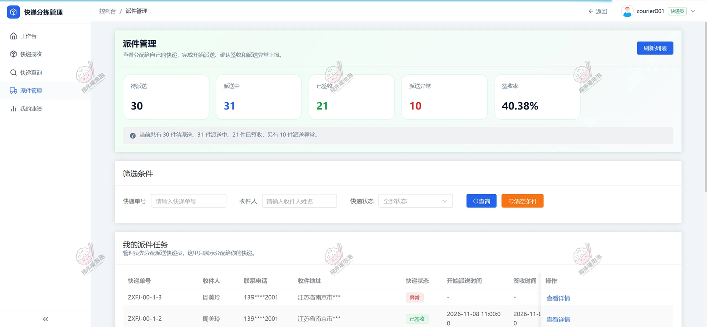

「我的派件任务」列单号、收件人、联系电话、收件地址、快递状态、开始派送时间、签收时间，操作是「查看详情」。ZXFJ-00-1-2 已签收、签收时间 2026-11-08 11:00:00；ZXFJ-00-1-3 仍是异常，没有开始派送时间。同一列表里能看出哪些件卡住了。

#### 我的业绩

四张卡：本月揽收量 39、本月派送量 15、本月签收量 6、签收率 40%，提示「刘洋当前排名第 3 / 4 名，本月累计签收 6 件，签收率 40%」。

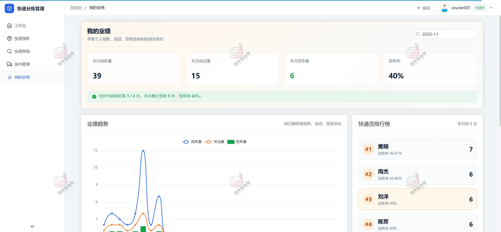

40% 对应 6 ÷ 15 的派送量，和排行榜里陈芳同样的 6 件 / 40% 并列第二梯队。右侧「快递员排行榜」：黄明 7 件 / 46.67%、周杰 6 件 / 42.86%、刘洋 6 件 / 40%、陈芳 6 件 / 40%——同样是 6 件，签收率按各自派送量算出来并不一样。

### 4.4 管理员端

左侧是完整后台菜单：控制台、快递管理（快递列表 / 物流轨迹 / 异常件）、分拣管理（分拣区域 / 分拣格口 / 分拣规则 / 分拣任务 / 分拣记录）、设备管理（设备监控 / 分拣设备 / 设备故障 / 维护记录）、人员管理（考勤记录 / 排班计划 / 绩效数据）、数据分析、用户管理（管理员 / 分拣员 / 快递员）、系统管理（系统公告 / 操作日志）。

#### 快递列表

筛选四项：快递单号、寄件人、收件人、快递状态。列表共 399 条，每页 10 条、40 页。

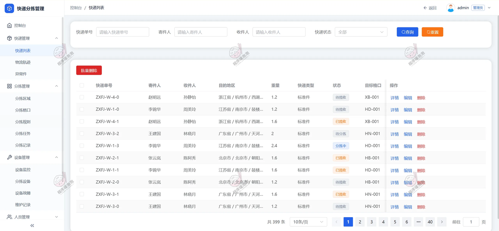

字段里两个值得看：「目的地区」写到省市两级（浙江省 / 杭州市 / 西湖区、江苏省 / 南京市 / 鼓楼区、北京市 / 北京市 / 朝阳区、广东省 / 广州市 / 天河区），「目标格口」跟着给出 HB-001、HD-001、HN-001、XB-001 这样的编码——省市区三级信息进去，格口编码出来，这就是规则匹配的结果落地。状态一侧同时存在待揽收、已揽收、待分拣、分拣中、派送中多种，配合右上角批量删除与每行详情 / 编辑 / 删除。

#### 物流轨迹

按快递和操作人两个条件筛，列表列单号、轨迹内容（查看详情）、账号与删除。

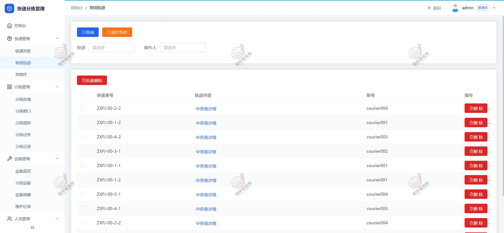

账号一列是 courier001 到 courier004 四位快递员，同一条单号会出现多行——每行是一次轨迹节点，点「查看详情」看节点内容与时间。管理员在这里既能追某一件走了哪些站，也能按人查某个快递员的操作记录。

#### 异常件

顶部两个环形图：左边按异常类型分（揽收、信息不全、漏分、错分、无法识别、破损、地址错误七类），右边按处理状态分（已处理、处理中、待处理）。

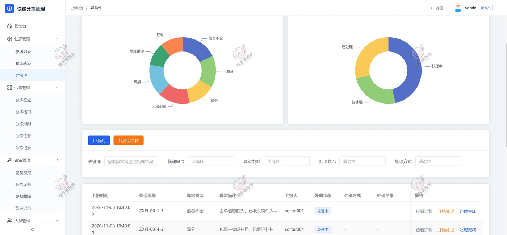

筛选支持关键词、单号、异常类型、处理状态、处理方式五个维度。列表两条：2026-11-08 10:40:00 的 ZXFJ-00-1-3「信息不全」，描述写着「面单信息缺失，已联系寄件人……」，上报人 sorter001，处理中；同一时刻的 ZXFJ-00-4-3「漏分」，描述是「包裹未完成扫描，已登记补扫」，上报人 sorter004，处理中。两条都能走「开始处理 / 处理完成」，处理动作会回写状态。

> ZXFJ-00-1-3 这一件在三处对得上：分拣员扫码页判为格口异常（目标 HD-001、实际 HD-002），分拣员异常上报页 10:40 上报「信息不全」处理中、处理人 admin，管理员异常件页同一时刻同一条记录同为「处理中」，快递员端待处理派件列表里它的状态也是「异常」。

#### 分拣规则

共 12 条规则，字段是规则名称、目的地、目标格口、优先级、状态、操作。右上角一个绿色「规则校验」按钮。

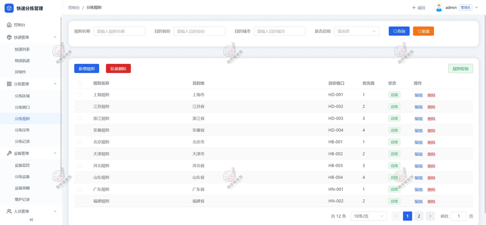

编码规律很清楚，按大区分前缀：沪苏浙皖四条都指 HD 系列（上海 HD-001 优先级 1、江苏 HD-002 优先级 2、浙江 HD-003 优先级 3、安徽 HD-004 优先级 4），京津冀鲁四条指 HB 系列（北京 HB-001 至山东 HB-004，同样 1 到 4），广东、福建两条指 HN 系列（HN-001、HN-002）。同一大区内用优先级决定谁先命中，越具体的省市规则优先级越高——这也正是冲突校验要盯的地方：优先级配反了，宽泛的省级规则就会把市级规则盖住。

#### 分拣任务

共 141 条任务，筛选支持任务编号、分拣区域、分拣员、任务状态。

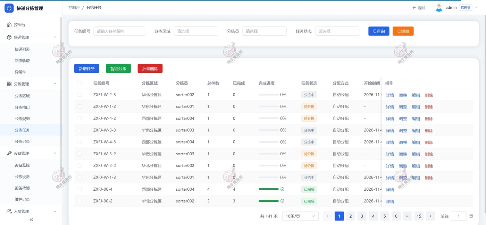

列表能看到负载均衡的痕迹：ZXFJ-W-2-3 华北分拣区 sorter002、ZXFJ-W-1-2 华东分拣区 sorter001、ZXFJ-W-4-2 西部分拣区 sorter004、ZXFJ-W-3-3 华南分拣区 sorter003——四个分拣区对应四位分拣员，一人一片，分配方式一列全写着「自动分配」。已完成的 ZXFJ-00-4（西部 4 件 4 完成）和 ZXFJ-00-2（华北 3 件 3 完成）进度条满格，其余 0/1 的还在待分拣或分拣中。操作有详情、调整、编辑、删除，「调整」就是人工改派。

#### 设备监控

六张卡：设备总数 10、在线设备 7、离线设备 1、故障设备 1、维护中 1、未解决报警 1。

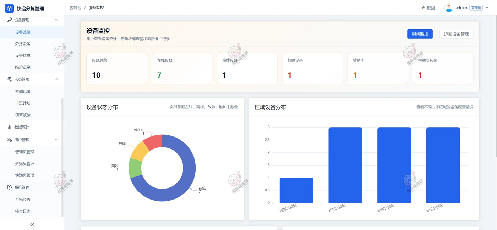

两个图各自成立：左边「设备状态分布」环形图 在线 7 + 离线 1 + 故障 1 + 维护中 1 = 10；右边「区域设备分布」柱图 西部 1 + 华东 3 + 华南 3 + 华北 3 = 10。两组数都收敛到总数 10，状态和区域是同一批设备的两个切面。

#### 分拣设备

设备台账，支持按名称 / 编号 / 品牌型号、类型、所属区域、状态筛选。

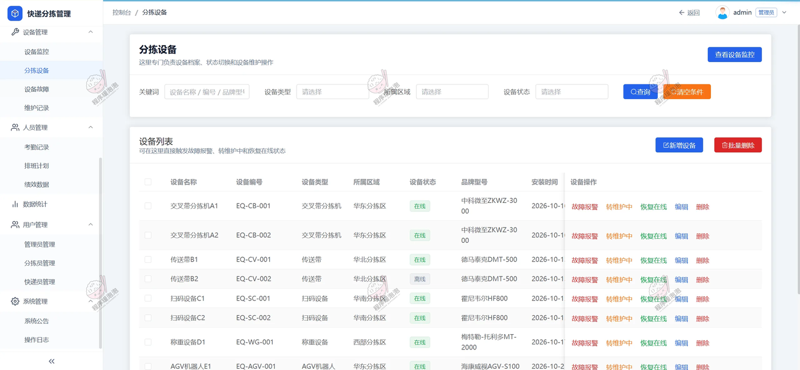

列表按类型成对铺开：交叉带分拣机 A1 / A2（EQ-CB-001、EQ-CB-002，中科微至 ZWXZ-3000，华东）、传送带 B1 / B2（EQ-CV-001、EQ-CV-002，德马泰克 DMT-500，华北，其中 B2 离线）、扫码设备 C1 / C2（EQ-SC-001、EQ-SC-002，霍尼韦尔 HF800，华南）、称重设备 D1（EQ-WG-001，梅特勒-托利多 MT-2000，西部）、AGV 机器人 E1（EQ-AGV-001，海康威视 AGV-S100，华东）。五类各两台正好 10 台，和监控页的设备总数对得上。操作列四个状态动作：故障报警、转维护中、恢复在线、编辑、删除——设备状态就是在这一页被改的。

#### 排班计划

顶部三张说明卡把三种操作讲明白了：高峰场景 1「整周工作日批量排班——一次选人、选班次、选区域，直接生成一周排班」；高峰场景 2「复制上周后微调——适合排班规律稳定的班组，省掉重复录入」；冲突策略「跳过或覆盖——批量前先预览冲突，避免重复安排同一天同一人」。

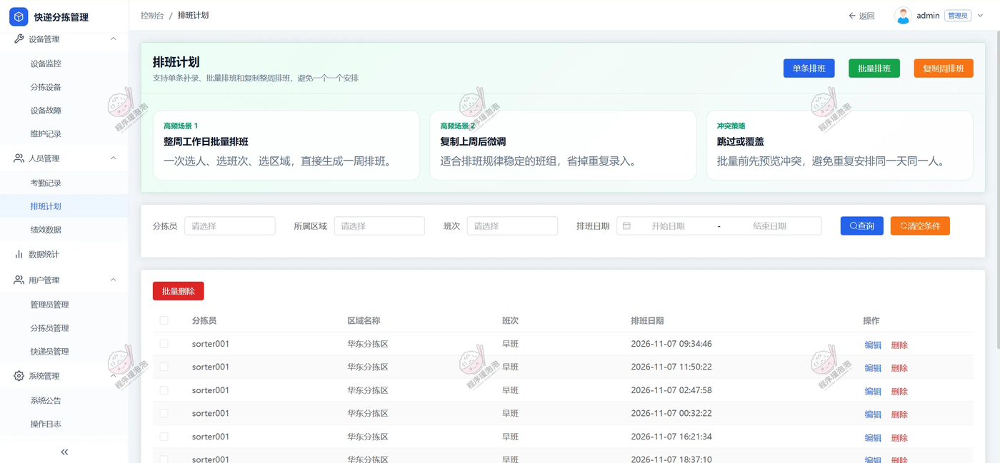

右上角对应三个按钮：单条排班、批量排班、复制周排班。下方列表按分拣员、区域名称、班次、排班日期排列，能直接看出 sorter001 在 2026-11-07 被排了 09:34:46、11:50:22、02:47:58、00:32:22、16:21:34、18:37:10 多条早班——同一人同一天重复排班，这就是「冲突」的具体形态，也是分拣员端显示「今日排班 9 个班次」的来源。

#### 绩效数据

六张卡：分拣总量 379、分拣准确率 94.72%、异常件数 45、揽收总量 395、签收总量 84、签收率 40.78%。筛选可按用户、角色、统计日期起止。

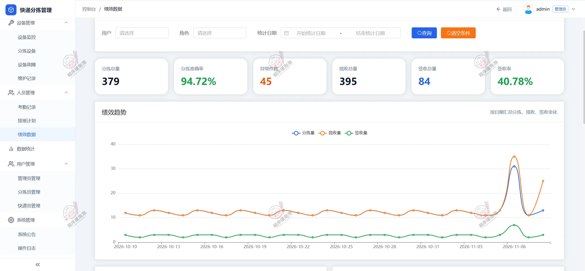

「绩效趋势」一张图叠三条线——分拣量、揽收量、签收量，横轴从 2026-10-10 拉到 11-08，10 月大部分时间平稳在 10 到 15 之间，到 11-06 附近三条线一起冲高（揽收量峰值最高，分拣量次之），随后回落。这是全局口径，和分拣员端、快递员端各自的个人绩效曲线不重复：一端看店，一端看人。

---

## 五、几个实现要点

**规则匹配与格口编码**。分拣规则按「目的地 → 目标格口」存，带优先级字段。匹配时按优先级从高到低逐条比对省、市、区三级，第一条命中的规则决定格口；一次匹配结束同时返回匹配成功与未匹配的条数，未匹配的包裹留在待处理池里等人看。格口编码按大区分前缀（HD / HB / HN / XB），同区内再按优先级编号，编码本身就能读出归属。

**负载均衡的分配时机**。分拣任务表里每行有分拣员、总件数、已完成数与任务状态。分配时统计每位分拣员「未完成」的任务条数（待分拣 + 分拣中），取最少的那个；分配完立刻把这条新任务计入负载，所以连续分多件时不会全压给同一个人。管理端「分配方式」列统一显示自动分配，需要人工干预时走「调整」改派。

**扫码核验的两段式**。先按单号查出目标格口（规则算出来的），再让分拣员确认实际格口（人真正放进去的）。两个值不一致就判「异常」，同时写一条分拣记录——记录里目标格口、实际格口、是否正确、分拣时间四个字段一个不少，事后能倒查是哪一步错的。判断为异常之后，分拣员可以走异常上报，填类型、说明、传图片，管理员在异常件页接手处理。

**设备状态与故障记录联动**。设备台账的「设备状态」是一个可被动作改写的字段：故障报警、转维护中、恢复在线三个动作直接改状态，同时生成的故障记录挂在同一台设备上。设备故障处理完，回写设备状态为在线并把未解决故障结掉，监控页的「未解决报警 1」就减一。所以监控页的六个数字不是各自统计的，而是同一批设备状态的不同聚合。

**排班的三条路径**。单条排班一次一条；批量排班按「人 + 班次 + 区域 + 日期区间」一次生成多条，生成前先跑一遍冲突预览，把同人同日同班次的重复列出来，再由管理员选跳过还是覆盖；复制周排班以某一周为模板平移到下一周，落库前同样走冲突检查。同一天同一人被排九次这种数据，正是没有走冲突预览的结果。

## 六、说明
- 文档展示 21 张截图，需要了解更多，请联系我。
